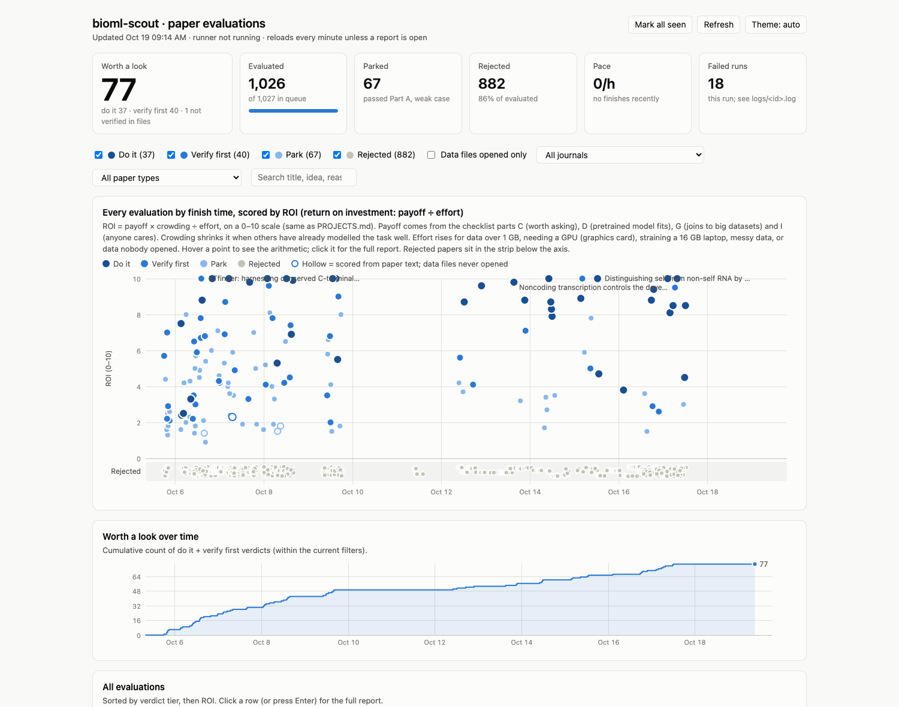

# bioml-scout

Edited: 10.14.2026

Author: haim krupkin (HK) +claude

Reads recent open-access biology papers, finds the data attached to them, opens that data, and
decides whether it is a good basis for a machine-learning project. 

We give a return on investment (ROI) score based on paramemters defined manually by HK which then an agentic swam reviews each paper and its resources according to these chemarks.
The checkamrks include data availability, novelty, diffuculty, impact, and many more.


**The dashboard** holds every evaluation, scored and browsable — hover a point for the one-line
idea and the arithmetic behind its score, click it for the full report.

**[⤓ Download the dashboard](../../raw/main/docs/dashboard.html)** (7 MB) — it saves as
`dashboard.html`; open it from your downloads and it renders as a page.



## Where it has got to

As of 14 October 2026, with the run still going: 774 of 1,027 papers evaluated, from 8 journals
published between 1 July and 1 October 2026.

| verdict | papers | what it means |
|---|---|---|
| **do it** | 25 | passed every deal-breaker, with the data opened and checked |
| **verify first** | 35 | looks good, but one specific count needs confirming |
| park | 62 | passed the deal-breakers, weak case |
| rejected | 652 | failed a deal-breaker — usually the data needs an access application, or the label would have to be constructed |


## How it works

Every paper is evaluated by its own fresh agent session, which is the whole design. A single long
conversation runs out of context after about fifteen papers and then keeps going, producing
confident nonsense without saying so. One paper per session, state on disk, resumable.

```
scripts/harvest.py      Europe PMC by ISSN and date  ->  queue.csv (1,027 papers)
scripts/prewarm.sh      fetches each paper's context ahead of the agent (no quota, just HTTP)
scripts/run_queue.sh    one `claude --agent paper-evaluator` per paper  ->  evaluations/<id>.json
scripts/rank.py         scores them in plain Python  ->  PROJECTS.md, projects.csv
scripts/dashboard.py    the browsable page            ->  dashboard.html
scripts/supervise.sh    restarts the run after a usage limit, a sleep or a crash
```

The agent itself is defined in [`.claude/agents/paper-evaluator.md`](.claude/agents/paper-evaluator.md):

```
ROI = payoff × crowding × known-labels ÷ effort        (0–10)
```

- **payoff** — the checklist parts for whether the question is worth asking, whether a pretrained
  model fits, whether it joins to a big dataset, and whether anyone would act on the result.
- **crowding** — shrinks the score when others have already modelled the task well. A crowded
  field can earn part of that back by answering four questions about what our edge actually is.
- **known-labels** — raises it when the thing being predicted is already measured publicly for
  many other items, which gives more training data and a ready-made external test set.
- **effort** — rises for working sets over 1 GB, needing a GPU, straining a 16 GB laptop, messy
  data, or data nobody opened.

The rubric is [`CHECKLIST.md`](CHECKLIST.md); the project's own constraints and conventions are in
[`CLAUDE.md`](CLAUDE.md). [`NOTES.md`](NOTES.md) records every design decision and the bugs behind
them, including the ones that cost a day.


## Installing

There is nothing to build and nothing to pip install: every script in `scripts/` uses only the
Python standard library.

```bash
git clone git@github.com:haimkru/bioml-scout.git
cd bioml-scout

python3 -V                 # 3.9 or newer; macOS ships 3.9, which is enough
claude --version           # the agent runner: https://claude.com/claude-code
```

That is the whole installation. To check it, read the evaluations already in the repo — both of
these work on a fresh clone, with no network and no API key:

```bash
python3 scripts/rank.py                      # -> PROJECTS.md, projects.csv
python3 scripts/dashboard.py --slim          # -> dashboard.html
open dashboard.html
```

## Running it

```bash
# 1. build the queue (writes queue.csv, then stops)
uv run --no-project --python 3.11 scripts/harvest.py --start 2026-07-01 --end 2026-10-01

# 2. start evaluating, and keep it running unattended
nohup ./scripts/supervise.sh 1 1x 300 > logs/supervise.out 2>&1 &
#                            │ │   └─ seconds between health checks
#                            │ └───── rest after each paper, as a multiple of its own time
#                            └─────── agents in parallel

# 3. read the results
python3 scripts/rank.py                 # PROJECTS.md + projects.csv
python3 scripts/dashboard.py --watch 60 # live dashboard.html
open dashboard.html

./scripts/supervise.sh --stop           # finishes the paper in flight, then stops
```

Pacing is important otherwise u will burn through tokens if tokens are given in a per hour/day basis.
Generally we have a setting to test on 10 papers initally and we can tweek the agents afterwards. its best to do htis at this stage.

For questions: contact hkrupkin@stanford. edu 
